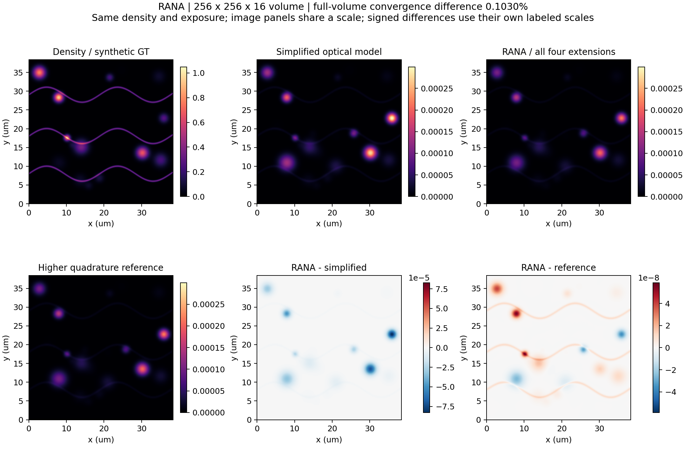

# RANA comparison

**RANA is theoretically more accurate:** the four extensions retain depth,
vector-field, sampling and temporal/spectral effects in the forward model.
This controlled 256×256×16 example measures their image effects and numerical
convergence. Standard MaoMi's separate **49.1× MATLAB speed comparison** remains
in the [overview](TECHNICAL_REPORT.md).



This benchmark uses the standalone global cubic RBF renderer. The optional
native acquisition add-on uses compact positive cubic interpolation, described
in the [integration guide](RANA_MODE.md).

## Same input, controlled ablations

| Route | Image difference vs RANA | Image difference vs higher quadrature |
| --- | --- | --- |
| RANA: all four extensions | 0.0000% | 0.1030% |
| One focal-depth field | 4.8823% | 4.8679% |
| Scalar instead of vectorial | 18.1929% | 18.1770% |
| Voxel/scan center sampling | 1.3943% | 1.3574% |
| Monochromatic, transform-limited pulse | 11.7765% | 11.7692% |
| All four simplifications | 30.3091% | 30.2885% |


Metric: **100 × relative L2 over the full noiseless XYZ volume**, with identical
density and exposure; no intensity fitting or per-image normalization.
The reference increases depth sites 3→5, angular nodes 16×40→24×64,
source-voxel quadrature 3→4 per axis, scan quadrature 2→3, and spectral samples
33→49. RANA's difference from this finer numerical reference is **0.1030%**.
The image difference from each ablation quantifies the modeled effect.

The scene uses NA 1.1, 920 nm excitation, specimen index 1.38 versus immersion
1.33, 50–62 µm focal depth, 0.15×0.15×0.75 µm voxels and 21×21×9 kernels.
The scan moves 0.18 µm during each dwell. A 100 fs pulse with 1800 fs² GDD
broadens to **111.76 fs**. The supplied emission
spectrum and detector curve give **75.88%** collection.
The monochromatic control keeps the same incident fluence and analytic
transform-limited temporal scale. XY entrance optics are uniform in this depth
comparison; [the custom-field example](../examples/enhanced_full_field.py)
exercises XY-varying shapes and gains separately.

## Measured cost

| Stage | Time |
| --- | --- |
| Full RANA PSF bank, CPU construction | 23.419 s |
| RANA CUDA renderer preparation | 0.024 s |
| CPU image render, warm median of 3 | 0.2057 s |
| CUDA image render, warm median of 3 | 0.0876 s |
| Rendering acceleration, identical PSF bank | 2.35× |
| CPU/CUDA full-image difference | 4.07e-14% |

Ryzen 9 7950X / RTX 3080, serial execution. PSF construction is CPU work;
the rendering speed ratio compares the same prepared physical model. I/O is
outside timing. Exact equality of all supplied XY kernels permits an exact
constant-basis reduction; varying fields retain the complete cubic basis.

## Reproduce

```sh
python -m pip install ".[examples]"
python examples/rana_comparison.py --device cuda --output artifacts/rana_comparison
```

Use `--device cpu` on machines without CUDA. An optional `--reference-cache`
can reuse a completed reference after checking the physical protocol; its
image checksum is recorded. Reference timings then belong to the saved run.
The [compact results](rana_comparison.json) include all acquisition parameters,
individual timings and metric definitions. Local raw arrays and logs are
excluded from the public package. See [model equations](RANA_PHYSICS.md).
