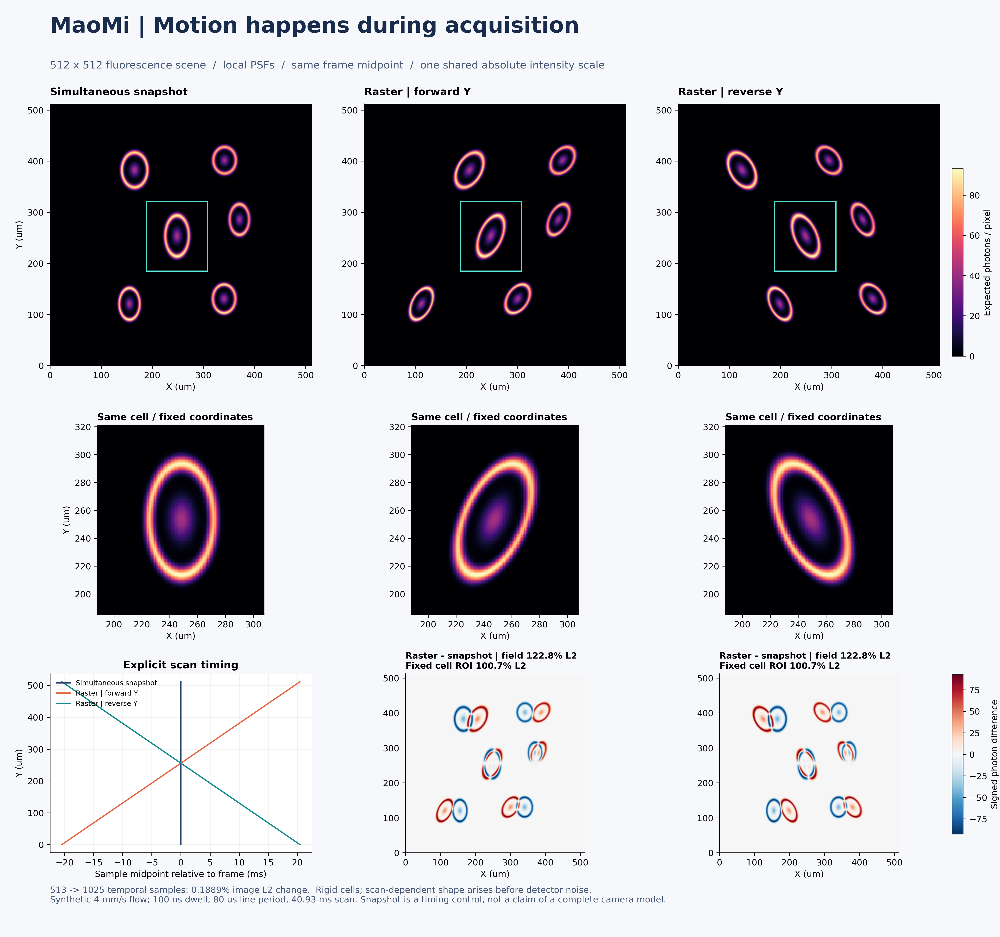

# Time-resolved acquisition

MaoMi can sample changing fluorescence and moving specimens within a frame.
Use `acquisition.timing` in the same scene configuration for Standard or RANA.
Omitting that section retains the existing MATLAB-compatible acquisition path.

```sh
python -m maomi run --demo --config examples/timed_acquisition.json --output artifacts/timed
python -m maomi run --demo --config examples/timed_acquisition.json --rana --output artifacts/timed_rana
python -m maomi resume artifacts/timed_rana
```

Use your own tissue, activity and PSF provider through the usual inputs.
There is no additional mode switch. Static `render` produces an instantaneous
XYZ stack; timing applies to `run` movies.

## Choose the acquisition clock

| Clock | Sample timing | Typical role |
| --- | --- | --- |
| `raster` | Sequential X pixels, then Y lines; optional alternating X direction | Point-scanning microscopy |
| `rolling` | Simultaneous X pixels within each Y row; rows have different midpoints | Row exposure timing or a detector callback |
| `global` | Every pixel has the same exposure window | Simultaneous-sampling control or a detector callback |

Arrays are XY. Slow scan is Y; fast raster scan is X. `reverse` reverses the
Y acquisition order. `bidirectional` reverses X on alternating acquired lines.
The mean of the first and last pixel midpoints is always the frame midpoint,
so comparisons do not introduce a hidden half-frame translation.

`exposure_s` is per-pixel integration time (dwell for a raster scan).
`pixel_period_s` includes that dwell. `line_period_s` includes all raster pixels
and any flyback. A complete acquisition must fit `scene.spikes['dt']`, the frame
interval. Frame `i` is centered at `i * dt`. In a rolling clock, zero line period
reduces exactly to a global clock.

This clock describes when a signal is sampled. Changing it does not turn a
two-photon excitation model and PMT noise model into a complete widefield sCMOS
instrument. For a camera, pass a detector-plane photon-rate renderer to the
independent clock and apply the camera's noise model afterward. Actual cameras
can use split or other row schedules; the built-in rolling clock is one linear
sweep. See [Andor's timing explanation](https://andor.oxinst.com/learning/view/article/rolling-and-global-shutter).

## What is integrated

For each temporal snapshot, the shared movie adapter:

1. Interpolates the cell activity at the requested time.
2. Translates the fluorescence density in XYZ using `velocity_voxels_s`.
3. Applies fixed excitation/collection masks and the Standard or RANA optical
   operator at the new specimen position, including available optical tails.
4. Crops and bins the instantaneous expected photon-rate image.
5. Integrates each pixel over its own time window, sums incoherent beams, and
   samples the existing detector noise and pixel bleed once.

RANA retains complete local PSFs. Motion happens before those PSFs are applied;
it is not a warp of a finished image. The translated object is fluorescence in a
fixed optical medium. Moving vessels or changing scattering require a provider
that updates that optical medium too.

`photon_rate_scale` converts optical response to photons/s. Its default is 1;
choose it from source/detector calibration or declare it as a synthetic photon
budget. This route does not apply the old frame-based `tpm` scaling. Exposure
duration is applied exactly once. `clean` contains expected photon counts;
`noisy` contains the existing NAOMi detector observation units.

RANA physics kernels that already include `acquisition.dwell_seconds` are
converted back to rates before temporal integration. Custom integrated PSFs can
declare `kernel_exposure_s` in their provenance for the same conversion. Other
custom fields must already describe an instantaneous response. This conversion
leaves the archived provider field unchanged and prevents double exposure scaling.

Activity values are defined at frame midpoints, linearly interpolated, and held
at the first/last value outside the trace. There is no activity cutoff in this
route. The reference specimen is at time zero; positive velocity moves it toward
positive coordinates, and density outside the supplied volume is zero. Supply
enough source margin for the requested motion. `scan_buff` selects a symmetric
crop, `sfrac` sums complete pixel bins, and `zoffset` selects the fixed focal slab.
Legacy randomized/supplied row offsets are replaced by the explicit velocity.

## Accuracy and cost

`samples` is the number of instantaneous optical snapshots across the full
frame acquisition window. Their piecewise-linear interpolation is integrated
analytically over each pixel window. Constant and linear photon rates integrate
exactly, up to numerical precision. Refine `samples` and compare complete images
for faster motion or nonlinear temporal signals; there is no universal sample
count that fits every specimen.

Only a rate image and accumulator are retained, so memory does not grow with
the number of temporal snapshots. RANA reuses its bounded FFT cache. Stationary
scenes with unchanged activity reuse their optical image, including across
frames. More snapshots increase work for a changing specimen.

The independent core accepts any nonnegative instantaneous photon-rate callback:

```python
from maomi import AcquisitionClock

clock = AcquisitionClock('rolling', exposure_s=0.001,
                         line_period_s=0.00002, samples=129)
plan = clock.plan((512, 512))
# render_photon_rate(t_seconds) -> finite nonnegative XY photons/s
expected_counts = plan.integrate(render_photon_rate, center_s=0.1)
```

This module imports NumPy only. It does not depend on RANA, the NAOMi-derived
host, PyTorch, a detector, or a GUI. The shared workflow adapter lives in
`maomi/_timed_movie.py`.

## Inspect and reproduce

Movie archives record the resolved clock, units, motion and interpolation rules
in `run.json`. Chunks include `time_s`; `MovieDataset[i]` returns that midpoint
with the clean/noisy pair. Resume uses archived settings and per-frame noise
seeds. Standard/RANA, cytosolic/nuclear labels, multiple beams and component GT
use the same time-aware entry point.

```sh
python examples/timed_acquisition.py --output artifacts/timing_comparison --device cpu
```

This produces a 512 x 512 synthetic moving-cell comparison, a PDF, and numerical
metrics. Each image uses the same frame midpoint and display scale. The figure
shows the full field, a fixed cell ROI, explicit sample times and signed
differences. It also checks 513 against 1025 temporal snapshots with a 0.2% image
L2 threshold. The snapshot is a simultaneous-sampling control.



`maomi.comparison.compare_images` reports whole-field and displayed-ROI metrics
separately, with no image alignment, gain fitting or per-image normalization.
An unchanged region can have zero ROI error while the whole image differs.
An exact equality control should look identical.
